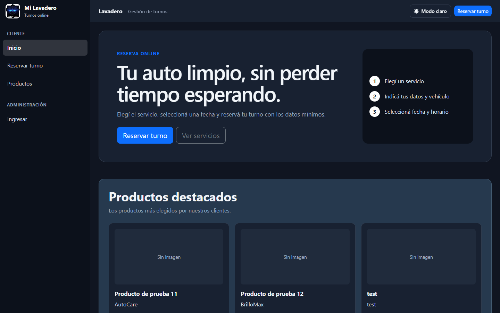
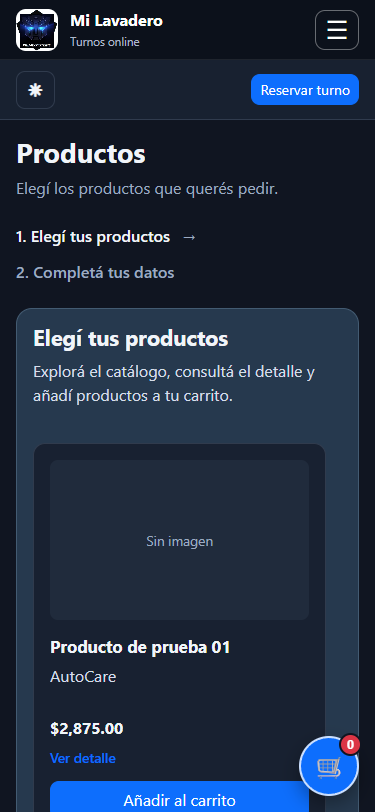

# Lavadero

[](https://github.com/JulietaN94/ProjectEDI26/actions/workflows/lavadero-ci.yml)
[](https://github.com/JulietaN94/ProjectEDI26/actions/workflows/lavadero-azure.yml)

Sistema web de gestión de turnos para un lavadero de autos, desarrollado como proyecto académico con C# y .NET 8.

La aplicación permite que un cliente reserve un turno sin registrarse y que el administrador gestione servicios, horarios, turnos, configuración y datos del negocio.

También incluye un catálogo público de productos, carrito de compra y recepción de pedidos sin registro ni control de stock.

## Aplicación publicada

- Aplicación: <https://lavadero-edi26-2026.azurewebsites.net>
- Estado de la base de datos: <https://lavadero-edi26-2026.azurewebsites.net/health>

El despliegue se realiza automáticamente desde `main` mediante GitHub Actions. La disponibilidad de estas direcciones debe comprobarse después de cada despliegue.

## Capturas

### Inicio y productos destacados



### Catálogo y carrito en móvil



## Tecnologías

- C#
- .NET 8
- Blazor Web App
- Interactive Server
- Entity Framework Core 8
- SQL Server
- ASP.NET Core Identity
- Bootstrap
- CSS Isolation
- JavaScript Interop
- Git

## Arquitectura

La solución está separada en cuatro proyectos:

```text
Lavadero.Domain
    Entidades y enums del dominio.

Lavadero.Application
    DTOs, modelos e interfaces de servicios.

Lavadero.Infrastructure
    Entity Framework Core, Identity, acceso a datos y servicios.

Lavadero.Web
    Interfaz Blazor, páginas, componentes, estado y endpoints web.
```

Las dependencias siguen este sentido:

```text
Domain
  ↑
Application
  ↑
Infrastructure
  ↑
Web
```

Más información en `docs/ARQUITECTURA.md`.

## Funcionalidades principales

### Cliente

- Consultar servicios disponibles.
- Reservar sin crear una cuenta.
- Ingresar nombre, teléfono, marca y modelo del vehículo.
- Elegir únicamente días y horarios habilitados.
- Disponibilidad calculada según la duración completa del servicio.
- Confirmar una reserva mediante enlace seguro.
- Cancelar una reserva mediante enlace seguro.
- Acceso manual a WhatsApp desde la confirmación.
- Consultar el catálogo y el detalle de cada producto.
- Agregar productos al carrito y modificar cantidades.
- Enviar pedidos informando solamente nombre, apellido y celular.

### Administrador

- Inicio de sesión con ASP.NET Core Identity.
- Dashboard.
- Gestión de turnos.
- Historial.
- Gestión de servicios.
- Configuración de horarios de atención.
- Configuración del lavadero.
- Cambio de datos de la cuenta.
- Carga y eliminación del logo.
- Modo claro y oscuro.
- Gestión del catálogo de productos.
- Consulta y actualización del estado de pedidos.
- Pedidos recientes visibles en el dashboard.

## Estados de un turno

```text
Pendiente
 ├──> Confirmado
 └──> Cancelado

Confirmado
 ├──> Completado
 └──> Cancelado
```

Un turno cancelado deja de bloquear el horario correspondiente.

## Confirmación y cancelación públicas

Al crear una reserva se generan dos tokens criptográficamente aleatorios:

- `TokenConfirmacion`
- `TokenCancelacion`

Las rutas públicas son:

```text
/confirmar-turno/{token}
/cancelar-turno/{token}
```

El `Id` del turno no se utiliza como credencial pública.

Las operaciones sensibles validan estado y fecha del turno. La confirmación y cancelación se ejecutan mediante actualizaciones atómicas en SQL.

Las páginas con tokens se marcan con `noindex` y `no-referrer`.

## Protección contra doble reserva

La disponibilidad se vuelve a validar al guardar.

Además, la creación de reservas utiliza una transacción y un bloqueo de aplicación de SQL Server mediante `sp_getapplock`, separado por fecha. Esto evita que dos solicitudes simultáneas puedan guardar turnos superpuestos después de haber visto el mismo horario como disponible.

## Base de datos

La aplicación utiliza SQL Server mediante Entity Framework Core.

Entidades principales:

```text
Cliente
Auto
Servicio
Turno
HorarioAtencion
ConfiguracionLavadero
ApplicationUser
Producto
Pedido
DetallePedido
```

Migraciones actuales:

```text
CreacionInicial
AgregarIdentityYConfiguracion
AgregarLogoLavadero
AgregarConfirmacionTurnos
AgregarTokenCancelacionTurnos
AgregarCatalogoPedidos
AgregarDatosDemo
```

La migración `AgregarDatosDemo` incorpora servicios y productos reproducibles para demostrar búsqueda, paginación, catálogo y carrito en una instalación nueva.

## Configuración local

La cadena de conexión se obtiene desde:

```text
ConnectionStrings:DefaultConnection
```

El proyecto incluye una configuración local de desarrollo, pero para otros entornos se recomienda sobrescribirla mediante configuración externa o User Secrets.

La contraseña inicial del administrador NO debe guardarse en `appsettings.json`.

Desde la carpeta que contiene la solución:

```powershell
dotnet user-secrets set "AdminSeed:Password" "TU_PASSWORD_SEGURA" --project Lavadero.Web
```

La contraseña debe cumplir las reglas configuradas por Identity:

- mínimo 8 caracteres;
- una mayúscula;
- una minúscula;
- un número.

También se pueden configurar mediante User Secrets:

```powershell
dotnet user-secrets set "AdminSeed:Usuario" "admin" --project Lavadero.Web
dotnet user-secrets set "AdminSeed:Email" "admin@lavadero.local" --project Lavadero.Web
dotnet user-secrets set "AdminSeed:NombreCompleto" "Dueño del lavadero" --project Lavadero.Web
```

## Ejecutar el proyecto

Restaurar dependencias:

```powershell
dotnet restore
```

Compilar:

```powershell
dotnet build
```

Ejecutar las pruebas:

```powershell
dotnet test Lavadero.Tests/Lavadero.Tests.csproj
```

Ejecutar:

```powershell
dotnet run --project Lavadero.Web
```

Al iniciar la aplicación se ejecutan las migraciones pendientes mediante `ApplyDatabaseMigrationsAsync()` y luego se realiza el seed del administrador.

También pueden aplicarse manualmente desde Package Manager Console:

```powershell
Update-Database -Project Lavadero.Infrastructure -StartupProject Lavadero.Web -Context LavaderoDbContext
```

## Health check

La aplicación expone:

```text
/health
```

El health check verifica el acceso a la base de datos.

## Integración y despliegue continuo

El repositorio contiene dos workflows:

- `lavadero-ci.yml`: restaura, compila, ejecuta las pruebas y publica un artefacto en pushes y pull requests hacia `main` o `develop`.
- `lavadero-azure.yml`: restaura, compila, ejecuta las pruebas, publica la aplicación y despliega Azure App Service en cada push a `main`.

El perfil de publicación se almacena exclusivamente en el secret de GitHub `AZUREAPPSERVICE_PUBLISHPROFILE`.

## Seguridad implementada

- ASP.NET Core Identity.
- Rol `Administrador`.
- Bloqueo temporal tras intentos fallidos de acceso.
- Cookies `HttpOnly`.
- Cookies `Secure`.
- `SameSite=Strict`.
- Antiforgery.
- Validación de mismo origen en carga/eliminación de logo.
- Tokens aleatorios para confirmación/cancelación.
- Validación de estado antes de cambiar un turno.
- Validación de datos también en capa de servicio para la creación de reservas.

## Documentación

```text
docs/
├── ARQUITECTURA.md
├── GUIA_FUNCIONAL.md
├── CONFIGURACION_DESARROLLO.md
├── DECISIONES_TECNICAS.md
└── VALIDACION_MANUAL.md
```

Además:

- `CHANGELOG.md`: cambios funcionales del proyecto.
- `CONTRIBUTING.md`: estrategia Git y Conventional Commits.

## Estado del proyecto

El proyecto incluye reservas, administración, autenticación, catálogo, carrito, pedidos, modo claro/oscuro, persistencia con EF Core, pruebas automatizadas y CI/CD para Azure.

La apertura manual de WhatsApp está disponible; el envío automático mediante WhatsApp Business API no forma parte del alcance actual.
