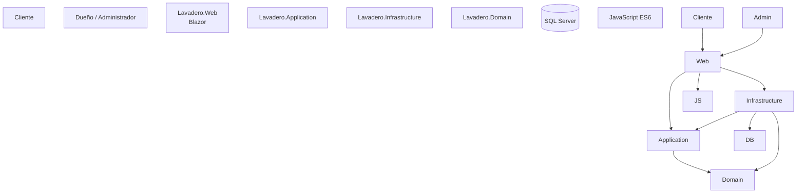

# Lavadero - Sistema de Gestión de Turnos

Aplicación web desarrollada en **C# con .NET 8 y Blazor Web App (Interactive Server)** para gestionar reservas de turnos de un lavadero de autos.

El sistema permite que un cliente reserve un turno **sin registrarse**, ingresando únicamente los datos necesarios.  
El dueño del lavadero dispone de un **área administrativa protegida** para gestionar turnos, servicios, horarios, historial, configuración general y su cuenta de usuario.

\---

# Objetivo del proyecto

El objetivo es construir una aplicación web simple, clara y funcional para resolver la gestión de turnos de un lavadero.

Se busca cubrir tanto el uso del cliente como la administración interna:

* El cliente puede consultar servicios y reservar un turno.
* No necesita crear una cuenta.
* El sistema valida horarios y evita superposición de turnos.
* El dueño puede iniciar sesión y administrar el negocio.
* Los datos persisten en SQL Server mediante Entity Framework Core.
* La aplicación utiliza buenas prácticas de desarrollo, Git, documentación y preparación para CI/CD.

\---

# Tecnologías utilizadas

* **C#**
* **.NET 8**
* **Blazor Web App**
* **Interactive Server**
* **Entity Framework Core 8**
* **SQL Server**
* **ASP.NET Core Identity**
* **Bootstrap 5**
* **CSS Isolation**
* **JavaScript Interop**
* **Git**
* **GitHub**
* **GitHub Actions** *(pendiente de configuración final)*
* **Azure App Service** *(pendiente de despliegue final)*

\---

# Arquitectura

La solución se divide en cuatro proyectos:

```text
Lavadero
│
├── Lavadero.Domain
├── Lavadero.Application
├── Lavadero.Infrastructure
└── Lavadero.Web
```

## Lavadero.Domain

Contiene las entidades y reglas principales del dominio.

Actualmente incluye, entre otras:

```text
Cliente
Auto
Servicio
Turno
HorarioAtencion
ConfiguracionLavadero
EstadoTurno
```

## Lavadero.Application

Contiene:

* Interfaces de servicios.
* DTOs.
* Requests.
* Modelos compartidos.
* Resultado paginado.

Ejemplos:

```text
IClienteService
IServicioService
ITurnoService
IHorarioAtencionService
IConfiguracionLavaderoService
IDashboardAdminService
PagedResult<T>
```

## Lavadero.Infrastructure

Contiene la implementación técnica:

* Entity Framework Core.
* `LavaderoDbContext`.
* `IDbContextFactory`.
* Configuraciones Fluent API.
* SQL Server.
* Migraciones.
* Datos seed.
* Servicios concretos.
* ASP.NET Core Identity.
* Logging.

## Lavadero.Web

Contiene:

* Páginas Blazor.
* Componentes Razor.
* Layouts.
* Login.
* Área administrativa.
* CSS.
* Bootstrap.
* JavaScript Interop.
* State Service.
* Health Check.

\---

# Flujo general



\---

# Cliente

El cliente **no necesita registrarse**.

Para reservar un turno se solicitan solamente:

```text
Nombre completo
Teléfono
Marca del vehículo
Modelo del vehículo
Servicio
Fecha y hora
Observaciones opcionales
```

El sistema intenta reutilizar clientes y vehículos ya existentes para evitar registros duplicados.

Ejemplo:

```text
Cliente existente
    ↓
mismo teléfono
    ↓
reutilizar cliente

Vehículo existente
    ↓
misma marca + modelo
    ↓
reutilizar auto

Turno
    ↓
nuevo registro
```

\---

# Gestión de turnos

Los turnos pueden tener los siguientes estados:

```text
Pendiente
Confirmado
Completado
Cancelado
```

Transiciones permitidas:

```text
Pendiente
   ├── Confirmado
   └── Cancelado

Confirmado
   ├── Completado
   └── Cancelado
```

No se permiten cambios incoherentes como:

```text
Completado → Pendiente
Cancelado → Confirmado
```

\---

# Validación de horarios

Antes de crear una reserva el sistema comprueba:

```text
Servicio activo
      ↓
Fecha futura
      ↓
Día habilitado
      ↓
Horario de atención
      ↓
Duración del servicio
      ↓
Turnos existentes
      ↓
Sin superposición
      ↓
Crear reserva
```

Ejemplo:

Si el lavadero trabaja:

```text
08:00 - 18:00
```

y el servicio dura:

```text
60 minutos
```

una reserva a:

```text
17:30
```

no será permitida porque finalizaría fuera del horario de atención.

\---

# Prevención de turnos superpuestos

Si existe:

```text
10:00 - 11:00
```

no puede reservarse:

```text
10:30 - 11:30
```

Los turnos cancelados no bloquean disponibilidad.

\---

# Servicios

El administrador puede gestionar los servicios del lavadero.

Cada servicio contiene:

```text
Nombre
Descripción
Precio
Duración en minutos
Activo / Inactivo
```

Funciones disponibles:

* Crear.
* Consultar.
* Editar.
* Eliminar.
* Buscar.
* Filtrar.
* Paginar.

Si un servicio ya tiene turnos asociados, no se elimina físicamente para preservar el historial.

En ese caso se recomienda:

```text
Activo = false
```

\---

# Precio histórico

El turno guarda el precio que tenía el servicio en el momento de realizar la reserva:

```text
Turno.PrecioServicio
```

Esto evita que un cambio posterior de precio modifique el historial.

Ejemplo:

```text
Septiembre:
Lavado completo = $10.000

Octubre:
Lavado completo = $15.000
```

El turno realizado en septiembre sigue mostrando:

```text
$10.000
```

\---

# Usuario administrador

El área administrativa utiliza:

```text
ASP.NET Core Identity
```

No se utiliza una implementación manual de contraseñas.

Identity administra:

* Usuarios.
* Password Hash.
* Cookies.
* Roles.
* Autenticación.
* Autorización.
* Cambio de contraseña.

Rol utilizado:

```text
Administrador
```

Las rutas administrativas están protegidas.

\---

# Rutas públicas y privadas

## Públicas

```text
/
/reservar
/login
```

## Administrador

```text
/admin
/admin/turnos
/admin/historial
/admin/servicios
/admin/horarios
/admin/configuracion
/admin/cuenta
```

Para acceder a `/admin/\*` se necesita:

```text
Rol = Administrador
```

\---

# Dashboard administrativo

El panel principal muestra indicadores como:

```text
Turnos de hoy
Pendientes
Confirmados
Completados
Ingresos del día
```

También permite visualizar los próximos turnos.

\---

# Historial

El dueño puede consultar turnos anteriores utilizando:

* Búsqueda.
* Fecha desde.
* Fecha hasta.
* Estado.
* Paginación.

Información mostrada:

```text
Fecha
Cliente
Teléfono
Vehículo
Servicio
Precio histórico
Estado
```

\---

# Horarios de atención

El administrador puede configurar los horarios por día.

Ejemplo:

```text
Lunes       08:00 - 18:00
Martes      08:00 - 18:00
Miércoles   08:00 - 18:00
Jueves      08:00 - 18:00
Viernes     08:00 - 18:00
Sábado      08:00 - 14:00
Domingo     Cerrado
```

Cada día puede activarse o desactivarse.

\---

# Configuración del lavadero

El administrador puede configurar:

```text
Nombre del lavadero
Teléfono
WhatsApp
Dirección
```

El número de WhatsApp se utiliza posteriormente en la confirmación de reservas.

\---

# WhatsApp

Después de crear una reserva, el cliente puede abrir WhatsApp con los datos del turno preparados.

Ejemplo del flujo:

```text
Reserva creada
     ↓
Confirmación
     ↓
Enviar por WhatsApp
     ↓
JS Interop
     ↓
WhatsApp
```

El sistema genera automáticamente un mensaje con:

* Número de turno.
* Fecha.
* Hora.
* Cliente.
* Vehículo.
* Servicio.

\---

# Modo oscuro

La aplicación incluye modo claro y oscuro.

Se utiliza:

```text
Blazor
   ↓
IJSRuntime
   ↓
JavaScript ES6
   ↓
localStorage
```

La elección se conserva aunque el usuario recargue la página.

\---

# JavaScript Interop

El archivo:

```text
wwwroot/js/lavaderoInterop.js
```

implementa funcionalidades que requieren APIs del navegador.

Entre ellas:

```text
inicializarTema()
establecerTema()
copiarAlPortapapeles()
abrirWhatsApp()
```

Los módulos JavaScript se cargan utilizando:

```csharp
IJSRuntime
IJSObjectReference
```

y se liberan mediante:

```csharp
IAsyncDisposable
```

\---

# Portapapeles

Mediante JS Interop el sistema permite:

* Copiar los datos de una reserva.
* Copiar el teléfono de un cliente desde administración.

\---

# Componentes Razor reutilizables

El proyecto posee más de los 6 componentes reutilizables solicitados.

Entre ellos:

```text
PageHeader
AlertMessage
LoadingSpinner
Paginacion
ServicioCard
EstadoTurnoBadge
TurnoCard
ConfirmDialog
UltimaReserva
ThemeToggle
ReservaConfirmacion
```

Los componentes utilizan:

```csharp
\[Parameter]
EventCallback<T>
```

para comunicación entre componentes.

\---

# State Service

El proyecto utiliza:

```text
ReservaState
```

para mantener y notificar el estado de la última reserva.

Ejemplo:

```csharp
ReservaState.EstablecerUltimaReserva(turno);
```

Los componentes pueden reaccionar mediante:

```text
OnChange
```

\---

# Interfaz visual

La interfaz utiliza:

* HTML5 semántico.
* Bootstrap 5.
* CSS Grid.
* Flexbox.
* CSS Isolation.
* Variables CSS.
* Diseño responsive.
* Mobile-first.

Se utilizan elementos como:

```html
<header>
<nav>
<main>
<section>
<article>
<aside>
<footer>
```

\---

# Responsive

La aplicación está preparada para:

```text
Desktop
Tablet
Mobile
```

En pantallas pequeñas:

* Los formularios pasan a una columna.
* Los botones se adaptan al ancho.
* Las tarjetas reorganizan su contenido.
* La navegación se adapta.
* Las tablas permiten scroll horizontal cuando es necesario.

\---

# Base de datos

Se utiliza:

```text
SQL Server
```

con:

```text
Entity Framework Core 8
```

y:

```text
IDbContextFactory<LavaderoDbContext>
```

Esto es especialmente importante en Blazor Server para utilizar contextos de corta duración.

\---

# Relaciones principales

```text
Cliente 1 ─────── N Auto

Auto 1 ────────── N Turno

Servicio 1 ────── N Turno
```

\---

# Migraciones

Las migraciones de Entity Framework Core se versionan en Git.

Ejemplos:

```text
CreacionInicial
AgregarIdentityYConfiguracion
```

Nunca debe agregarse `Migrations/` al `.gitignore`.

\---

# Seed

El proyecto utiliza datos iniciales para facilitar el desarrollo y la demostración.

Ejemplos:

```text
Servicios iniciales
Horarios de atención
Configuración del lavadero
Rol Administrador
Usuario administrador inicial
```

El usuario administrador se crea utilizando ASP.NET Core Identity.

\---

# User Secrets

Las credenciales de desarrollo no deben guardarse en Git.

Para configurar la contraseña inicial:

```bash
dotnet user-secrets set "AdminSeed:Password" "TU\_PASSWORD\_SEGURA"
```

Para configurar una cadena de conexión:

```bash
dotnet user-secrets set "ConnectionStrings:DefaultConnection" "TU\_CONNECTION\_STRING"
```

\---

# Health Check

La aplicación expone:

```text
/health
```

Este endpoint verifica que la aplicación pueda conectarse correctamente a SQL Server.

Resultado esperado:

```text
Healthy
```

\---

# Logging

Los servicios principales utilizan logging estructurado mediante:

```csharp
ILogger<T>
```

Ejemplos de operaciones registradas:

```text
Creación de servicio
Actualización de servicio
Eliminación de servicio
Creación de turno
Cambio de estado de turno
Errores de disponibilidad
Errores de conexión
```

No se registran datos sensibles como contraseñas.

\---

# Configuración por ambientes

El proyecto contempla:

```text
appsettings.json
appsettings.Development.json
appsettings.Production.json
```

En producción las credenciales deben configurarse mediante variables de entorno.

Ejemplo:

```text
ASPNETCORE\_ENVIRONMENT=Production
ConnectionStrings\_\_DefaultConnection=<connection-string>
AdminSeed\_\_Password=<password>
```

\---

# Instalación

## 1\. Clonar repositorio

```bash
git clone URL\_DEL\_REPOSITORIO
```

## 2\. Entrar al proyecto

```bash
cd ProjectEDI26/Lavadero
```

## 3\. Restaurar paquetes

```bash
dotnet restore
```

## 4\. Configurar User Secrets

Desde `Lavadero.Web`:

```bash
dotnet user-secrets set "AdminSeed:Password" "TU\_PASSWORD"
```

Si corresponde:

```bash
dotnet user-secrets set "ConnectionStrings:DefaultConnection" "TU\_CONNECTION\_STRING"
```

## 5\. Aplicar migraciones

Desde Visual Studio, Consola del Administrador de paquetes:

```powershell
Update-Database -Project Lavadero.Infrastructure -StartupProject Lavadero.Web -Context LavaderoDbContext
```

## 6\. Ejecutar

```bash
dotnet run --project Lavadero.Web
```

\---

# Git y GitHub

El flujo de trabajo definido es:

```text
main
develop
feature/\*
release/\*
hotfix/\*
```

Ejemplo:

```bash
git switch develop
git switch -c feature/nueva-funcionalidad
```

\---

# Conventional Commits

Se utilizan commits con formato:

```text
feat: nueva funcionalidad
fix: corrección de error
docs: documentación
style: cambios de formato
refactor: refactorización
test: pruebas
chore: configuración o mantenimiento
```

Ejemplos:

```text
feat(web): implementar reserva de turnos
feat(auth): agregar usuario administrador
feat: agregar modo oscuro y WhatsApp
fix: corregir configuración de Identity
docs: agregar documentación profesional
```

\---

# Product Backlog

El proyecto cuenta con historias de usuario para:

```text
Reservar turno
Consultar servicios
Evitar superposición
Login administrador
Gestionar turnos
Consultar historial
Administrar servicios
Configurar horarios
Configurar lavadero
Modo oscuro
WhatsApp
Paginación
Dashboard
Gestión de cuenta
Deployment
```

Las historias utilizan:

```text
Como...
Quiero...
Para...
```

junto con:

* Criterios de aceptación.
* Story Points.
* Definition of Done.

\---

# Definition of Done

Una tarea se considera terminada cuando:

* Cumple los criterios de aceptación.
* Compila sin errores.
* Fue probada manualmente.
* No genera errores de consola.
* No contiene secretos.
* Respeta la arquitectura.
* Funciona en desktop y móvil cuando corresponde.
* Utiliza Conventional Commits.
* La documentación fue actualizada cuando aplica.

\---

# Archivos ignorados por Git

El `.gitignore` evita versionar:

```text
.vs/
bin/
obj/
\*.user
\*.suo
logs/
publish/
artifacts/
secrets.json
\*.pfx
\*.p12
\*.key
\*.pem
```

Las migraciones de Entity Framework **sí se versionan**.

\---

# Requisitos del Proyecto Integrador cubiertos

## Unidad 1

* ✅ Componentes Razor reutilizables.
* ✅ `EditForm`.
* ✅ Validaciones.
* ✅ Routing.
* ✅ State Service.
* ✅ Parámetros y eventos.

## Unidad 2

* ✅ HTML5 semántico.
* ✅ CSS Isolation.
* ✅ Bootstrap 5.
* ✅ Responsive mobile-first.
* ✅ JS Interop.
* ✅ Modo oscuro.
* ✅ `localStorage`.
* ✅ Clipboard API.
* ✅ Integración con WhatsApp.

## Unidad 3

* ✅ Entity Framework Core.
* ✅ SQL Server.
* ✅ `DbContextFactory`.
* ✅ Relaciones entre entidades.
* ✅ Fluent API.
* ✅ Migraciones.
* ✅ Seed.
* ✅ CRUD.
* ✅ Búsqueda.
* ✅ Paginación.
* ✅ Manejo de errores.

## Unidad 4

* ✅ `.gitignore`.
* ✅ Conventional Commits.
* ✅ Arquitectura documentada.
* ✅ README.
* ✅ CHANGELOG.
* ✅ Product Backlog.
* ✅ Definition of Done.
* ✅ XML Documentation.
* ✅ Logging.
* ✅ Configuración por ambientes.
* ✅ User Secrets.
* ✅ Health Check.
* ⏳ GitHub Issues y Project Kanban.
* ⏳ GitHub Actions.
* ⏳ CI/CD.
* ⏳ Azure.
* ⏳ URL pública.

\---

# Estado actual

```text
Fase 1   Base / Git                         ✅
Fase 2   Dominio                            ✅
Fase 3   EF Core / SQL Server               ✅
Fase 4   Application / Servicios            ✅
Fase 5   Interfaz Blazor / CRUD / Reservas  ✅
Fase 5.1 Identity / Administración          ✅
Fase 6   UX/UI / JS Interop                 ✅
Fase 7   Documentación / Logging / Health   ✅
Fase 8   CI/CD / Azure / Deployment         ⏳
```

\---

# Pendiente

Para finalizar el Proyecto Integrador:

* Crear/ordenar ramas Git definitivas.
* Crear Issues en GitHub.
* Crear GitHub Project con Kanban.
* Configurar Pull Requests.
* Configurar GitHub Actions.
* Ejecutar build automático.
* Configurar deployment automático.
* Crear Azure App Service.
* Configurar SQL Server de producción.
* Configurar secretos de Azure/GitHub.
* Desplegar aplicación.
* Obtener URL pública.
* Agregar capturas al README.
* Realizar pruebas finales.
* Preparar defensa del proyecto.

\---

# Proyecto Integrador

Proyecto desarrollado como trabajo integrador de **Desarrollo Web con Blazor**, aplicando los contenidos de:

```text
Unidad 1 - Componentes Blazor
Unidad 2 - HTML, CSS, Bootstrap y JavaScript Interop
Unidad 3 - Entity Framework Core y Persistencia
Unidad 4 - Integración, buenas prácticas y despliegue
```

El objetivo final es disponer de una aplicación funcional, documentada, versionada profesionalmente y desplegada en una URL pública.

